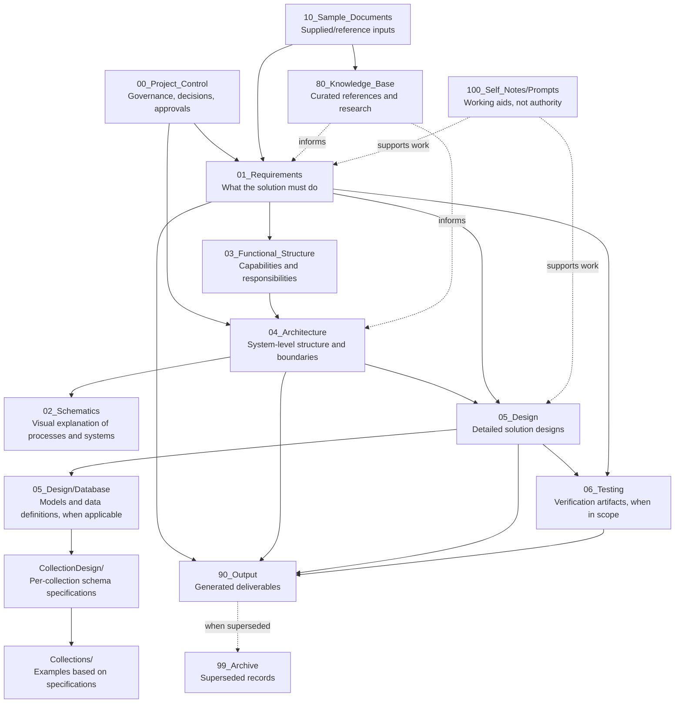

# Reusable Software Architecture Project Folder Guide

**Purpose:** Define a reusable folder structure for software architecture and solution-design projects. The folder names are preserved as the current project template; their descriptions are technology- and industry-neutral unless a folder explicitly names a technical artifact type.

## Project folder map

```text
<Project_Root>/
├── 00_Project_Control/
├── 01_Requirements/
├── 02_Schematics/
├── 03_Functional_Structure/
├── 04_Architecture/
├── 05_Design/
│   └── Database/                         (when the project includes data design)
│       ├── Collection_Inventory.md       (for document/collection databases)
│       ├── Data_Model.md                 (logical data model)
│       ├── Entity_Relationships.md        (relationship view)
│       ├── CollectionDesign/<domainCode>/ (per-collection specifications, if applicable)
│       ├── Collections/<domainCode>/      (example or seed data, if applicable)
│       └── BsonFiles/                     (BSON artifacts, only if applicable)
├── 06_Testing/
├── 10_Sample_Documents/
├── 80_Knowledge_Base/
├── 90_Output/
├── 99_Archive/
└── 100_Self_Notes/
    └── Prompts/
```

`<Project_Root>` is the root directory for a specific project. Angle-bracketed names are placeholders, not literal folder names. `Database`, `Collection_Inventory.md`, `CollectionDesign`, `Collections`, and `BsonFiles` are optional design areas for projects that use database collections or BSON. Use equivalent design subfolders that fit the chosen technology when those areas do not apply. `<domainCode>` is an optional grouping label selected for that project; it is not a prescribed industry or module code.

## Folder purposes

| Folder | Purpose and typical contents |
|---|---|
| `00_Project_Control` | Project governance and coordination: master instructions, project context, decision and change logs, folder guidance, plans, status tracking, and approval records. |
| `01_Requirements` | Business, user, functional, non-functional, security, data, interface, and operational requirements; use cases; acceptance criteria; constraints; and traceability materials. |
| `02_Schematics` | Visual process and system views such as flowcharts, context maps, sequence diagrams, deployment views, and other schematics. Keep source files and exported images together where practical. |
| `03_Functional_Structure` | Functional decomposition, capability or module definitions, process areas, workflows, responsibilities, and scope boundaries. Use project terminology rather than assuming a particular industry structure. |
| `04_Architecture` | Architecture decisions and views: system context, components, integrations, deployment, security, data flows, technology choices, and quality attributes. |
| `05_Design` | Detailed design artifacts derived from requirements and architecture. Organize by design concern, such as data, interfaces, components, user experience, security, or deployment. |
| `05_Design/Database` | Optional data-design area. Store inventories, conceptual/logical models, entity relationships, schema or collection specifications, and database-specific examples here. Use only the subfolders relevant to the project’s data technology. |
| `05_Design/Database/CollectionDesign/<domainCode>` | Optional collection-oriented design area. Store one detailed specification per collection, grouped by an agreed domain label. A specification typically documents purpose, fields, types, requiredness, validation, references, indexes, lifecycle, audit, assumptions, and open issues. |
| `05_Design/Database/Collections/<domainCode>` | Optional example-data area for collection-oriented projects. Store one example or seed-data file per collection, following the corresponding approved specification. Do not treat examples as production data unless explicitly approved. |
| `05_Design/Database/BsonFiles` | Optional location for BSON-formatted artifacts when the selected database and project workflow use BSON. Do not use it for unrelated binary files. |
| `06_Testing` | Verification planning and evidence where testing is in scope: test strategies, plans, cases, execution records, results, defects, and acceptance evidence. If software testing is outside scope, leave the folder unused and state that in project scope. |
| `10_Sample_Documents` | Supplied or reference documents used as inputs, examples, or source material. Preserve originals; generated deliverables belong in `90_Output` or their explicitly designated destination. |
| `80_Knowledge_Base` | Curated reference material used across the project, such as approved glossaries, research, standards references, technology documentation, and reusable internal guidance. Record source and relevance where appropriate. |
| `90_Output` | Generated project deliverables that do not have a more specific designated home. Organize outputs into clear subfolders, such as `Requirements`, `Design`, `Reports`, or `Presentations`. |
| `99_Archive` | Superseded or inactive project artifacts retained purely for historical reference. Do not read or use archived content as current project logic, requirements, constraints, decisions, or design authority. Do not overwrite archived originals. |
| `100_Self_Notes` | Internal notes, prompts, checklists, and process aids retained purely for reference. Do not read or use their contents to determine project logic, requirements, constraints, decisions, or design behavior. |
| `100_Self_Notes/Prompts` | Optional storage for reusable task prompts and workflow instructions retained for reference only. Do not treat prompt text as project logic or authority; follow current approved project artifacts and the current user request. |

## Artifact relationship and authority



The diagram shows a typical dependency flow, not a mandatory waterfall. Requirements, architecture, and design may be refined iteratively. `00_Project_Control` records authority and decisions. `100_Self_Notes` and `99_Archive` are reference-only: their contents must not be read or used to derive project logic or make project decisions. Current authoritative project artifacts and the current user request govern the work.

## Data and collection-design guidance

For projects using database collections, keep these artifacts distinct:

1. **Inventory:** identifies which collections are in scope and gives each collection a high-level purpose and owner.
2. **Data model and relationship view:** explains the domain entities and how they relate across the solution.
3. **Collection specification:** defines the schema for one collection, including every field’s name, type, meaning, requiredness, validation, reference behavior, indexes, and lifecycle rules.
4. **Example data:** demonstrates the approved field structure and conventions. It does not define or silently change the schema.

Approval should state its scope. Approval of a collection inventory does not automatically approve field-level schemas, and approval of a schema does not automatically approve sample data for production use. Record formal decisions and material artifact changes in the project’s decision and change records.

## Folder-use rules

1. Keep authoritative requirements, architecture, and design artifacts in their designated folders; link to them rather than creating competing copies.
2. Store a generated deliverable in its explicitly designated location. Otherwise, use an organized subfolder under `90_Output`.
3. Keep supplied source material in `10_Sample_Documents` and preserve the original.
4. Use clear filenames and follow project naming, versioning, and status conventions.
5. When a file moves or is renamed, update affected links and path references in the same change and record material changes in the project change log.
6. Use `99_Archive` only for superseded or inactive materials that must be retained; identify the current replacement where applicable.
7. Treat `100_Self_Notes` and `99_Archive` as reference-only folders. Do not read or use their contents for project logic, requirements, decisions, or design behavior. If useful material is to become authoritative, copy and review it into the appropriate current project folder and approve it there; until then it has no authority.
8. Do not create empty folders merely to match the template. Add optional subfolders when project contents justify them, and document project-specific deviations.

