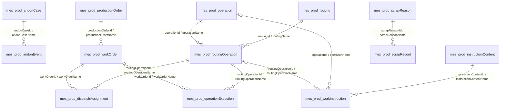

**FILE TYPE: PROJECT SPECIFIC**

# MES Entity Relationships — Production Execution Orders and Operations

Documentation workflow: GEN-001 / DEC-018 applies; routine authorized work requires consistency review and recorded material changes, without separate sign-off. Historical approval records remain historical.

**Document ID:** MES-DATA-ER-PROD-001  
**Version:** 0.7
**Status:** CURRENT 
**Date:** 2026-10-11
**Scope:** Complete MES entity and relationship model across all ten functional modules: Production Execution (`prod`), Traceability (`trace`), Quality Management (`qa`), Performance (`perf`), Planning & Scheduling (`plan`), Material Management (`matl`), Maintenance (`maint`), Manpower Management (`man`), Tool Management (`tool`), and Analytics (`ai`). Current detailed relationships cover selected Production Execution concepts; the other modules are in scope for incremental documentation.

## 1. Authority and scope

The Production Order / Work Order boundary is recorded in current `DEC-004`, reusable operation ownership in current `DEC-003`, and the current Andon case/event split in current `DEC-005` in `00_Project_Control/Decisions_Log.md`. Collection scope is listed in `05_Design/Database/Collection_Inventory.md`. This relationship view documents logical references; it does not imply MongoDB-enforced foreign keys.

The operation-to-routing-step relationship is based on the flat-document rule. Each relationship is stored on a separate flat document with scalar reference fields and matching display values. The declared scope is the complete ten-module MES; current detailed relationships cover selected Production Execution concepts only, and the other modules remain to be documented.

## 2. Relationship diagram

Diagram cardinalities describe the intended logical links. In particular, a work instruction may be operation-wide, routing-step-specific, or both only if the two references agree. Exact optionality remains subject to the collection specifications.

One Production Order may produce multiple Work Orders; zero-child handling, mandatory decomposition, and exact cardinality are not confirmed. The diagram indicates the parent-to-child direction, not a database-enforced constraint.

The current Andon relationship is one case to zero or more transition records; each event references exactly one case. `eventSequenceNo` orders a case's transitions. This relationship is current under DEC-005.

## 3. Relationship definitions

| Parent / referenced entity | Related entity | Cardinality | Stored reference | Consistency rule |
|---|---|---|---|---|
| Andon Case (`mes_prod_andonCase`) | Andon Event (`mes_prod_andonEvent`) | One case has zero or more transition events; each event belongs to exactly one case. | `andonCaseId` + `andonCaseName` on Andon Event | Event sequence is unique within its case; the case's current status/escalation level must agree with its latest applicable event. Detailed synchronization policy remains open. |
| Production Order (`mes_prod_productionOrder`) | Work Order (`mes_prod_workOrder`) | A Production Order may be broken down into multiple Work Orders; minimum and maximum cardinality require confirmation. | `productionOrderId` + `productionOrderName` on Work Order | Child work orders represent execution tasks within the parent's authorized product/batch demand. Quantity reconciliation rules remain open. |
| Work Order (`mes_prod_workOrder`) | Dispatch Assignment (`mes_prod_dispatchAssignment`) | One work order may have zero or more dispatch assignments; each assignment references one work order. | `workOrderId` + `workOrderName` | Dispatch assigns granular work to shop-floor resource; an optional routing step must belong to the work order's applicable routing. |
| Work Order (`mes_prod_workOrder`) | Operation Execution (`mes_prod_operationExecution`) | One work order may have zero or more operation-execution records; each execution references one work order. | `workOrderId` + `workOrderName` | Operation execution, labor, material, machine-time, scrap, and sign-off tracking contribute to work-order and overall order progress. |
| Operation (`mes_prod_operation`) | Routing Operation (`mes_prod_routingOperation`) | One operation to zero or more routing-operation records; each routing-operation record references exactly one operation. | `operationId` + `operationName` | `operationId` identifies the operation document; copied `operationName` follows the current snapshot/synchronization rule. |
| Routing (`mes_prod_routing`) | Routing Operation (`mes_prod_routingOperation`) | One routing to zero or more steps; each step belongs to exactly one routing. | `routingId` + `routingName` | `sequenceNo` is unique within the routing once the compound uniqueness rule is defined. |
| Routing Operation | Dispatch Assignment (`mes_prod_dispatchAssignment`) | One routing step may be assigned zero or more times; a dispatch assignment may reference zero or one routing step under the current optional field proposal. | `routingOperationId` + `routingOperationName` | The selected step must belong to the routing applicable to the dispatched work order. |
| Routing Operation | Operation Execution (`mes_prod_operationExecution`) | One routing step may have zero or more execution records; each operation execution references exactly one routing step. | `routingOperationId` + `routingOperationName` | Execution work order/routing revision must match the referenced step. |
| Routing Operation | Work Instruction (`mes_prod_workInstruction`) | One routing step may have zero or more applicable instructions; a work instruction may optionally reference one routing step. | `routingOperationId` + `routingOperationName` | If `operationId` is also populated, it must equal the step's `operationId`. |
| Operation | Work Instruction (`mes_prod_workInstruction`) | One operation may have zero or more operation-wide instructions; a work instruction may optionally reference one operation. | `operationId` + `operationName` | When the instruction is also routing-specific, its direct operation reference must agree with the routing-step operation. |
| Instruction Content Reference (`mes_prod_instructionContent`) | Work Instruction (`mes_prod_workInstruction`) | One registered content version may be referenced by zero or more Work Instructions; each Work Instruction references exactly one content version. | `instructionContentId` + `instructionContentName` | The referenced record identifies the exact content version; its external locator is opaque and the payload remains outside MongoDB. New Work Instructions reference active content records. |
| Scrap Reason (`mes_prod_scrapReason`) | Scrap Record (`mes_prod_scrapRecord`) | One reason may be referenced by zero or more Scrap Records; each Scrap Record references exactly one reason. | `scrapReasonId` + `scrapReasonName` | New Scrap Records reference active reasons; retired reasons remain valid for historical references. |

## 4. Reference and index notes

- The referenced system ID is the target collection's `_id`; MongoDB reference fields are strings under the project convention.
- Every reference includes its paired display field. Audit references retain the standard `createdById`/`createdBy` and `updatedById`/`updatedBy` pairs.
- Recommended indexes include `mes_prod_routingOperation.routingId + sequenceNo`, `mes_prod_routingOperation.operationId`, consumer-side `routingOperationId` fields where query patterns require them, `mes_prod_scrapReason.scrapReasonCode`, and `mes_prod_instructionContent.instructionContentLocator`.
- Recommended Andon indexes include `mes_prod_andonEvent.andonCaseId + eventSequenceNo` and `mes_prod_andonCase.workCenterId + status`; exact query patterns and uniqueness rules remain open.
- Index uniqueness, query workload, name snapshot behavior, and reference validation remain OPEN until documented in the relevant collection specification.

## 5. Flat-document representation

No operation list is embedded in a routing, and no event list is embedded in an Andon case. Each routing step and each Andon transition is an independent flat document. Dispatch assignments, executions, work instructions, scrap records, and Andon events store scalar references to their related records. External instruction payloads remain outside MongoDB. No nested documents or arrays are represented by this model.

## 6. Open issues

1. Confirm operation-code uniqueness and operation lifecycle rules.
2. Confirm `routingOperationName` as the display value for a routing-specific step.
3. Confirm whether work instructions may carry both operation and routing-operation references.
4. Confirm routing-step unique index and effectivity behavior.
5. Complete this relationship model as other collection specifications are documented and checked for consistency.
6. Confirm Production Order decomposition cardinality, sales-order/demand-forecast references, and quantity reconciliation between parent demand and child execution.
7. Confirm permitted Andon state transitions, reopen and recipient behavior, and case/event consistency policy under current DEC-005; event type values and meanings are current under DEC-012.

## 7. Revision history

| Version | Date | Change | Approval |
|---|---|---|---|
| 0.1 | 2026-09-28 | Initial relationship model for operation master, routing steps, and Production Execution consumers, aligned with DEC-003. | APPROVED |
| 0.2 | 2026-09-28 | Added the Production Order → Work Order hierarchy and linked dispatch/execution to Work Order scope under DEC-004. | APPROVED |
| 0.3 | 2026-09-28 | Added proposed Andon Case → Andon Event relationship and flat case reference under pending DEC-005. | APPROVED |

| 0.4 | 2026-10-07 | Added the approved Scrap Reason and Instruction Content Reference relationships and updated the Work Instruction content model under DEC-008/DEC-009. | APPROVED |
| 0.5 | 2026-10-07 | Recorded the approved Andon event type vocabulary under DEC-012 and clarified which Andon behavior remains open. | APPROVED |
| 0.6 | 2026-10-08 | Align reference pairs with grammatically singular entity stems under DATA-003 / DEC-015. | APPROVED |
| 0.7 | 2026-10-11 | Declared the complete ten-module MES scope and clarified the current Production Execution-only relationship coverage for incremental completion. | CURRENT |

Documentation update — 2026-10-11: Apply GEN-001 / DEC-018; remove separate documentation sign-off gates, retain open requirements and operational controls, and use current artifact status. See CHG-022.

